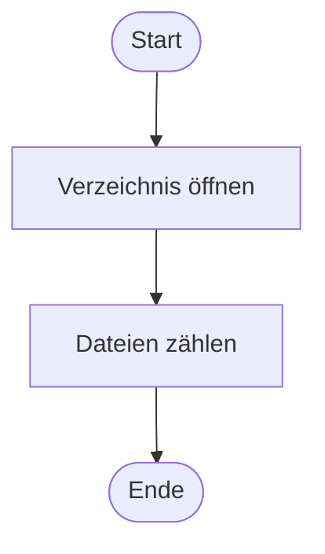
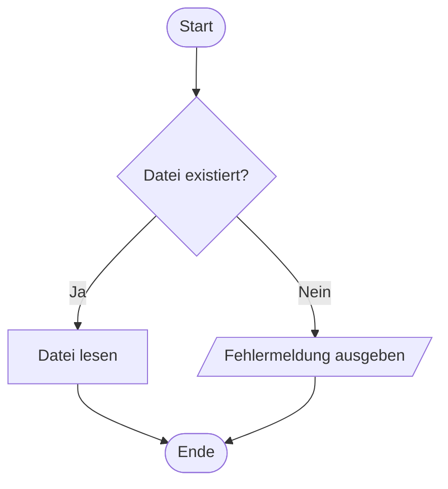
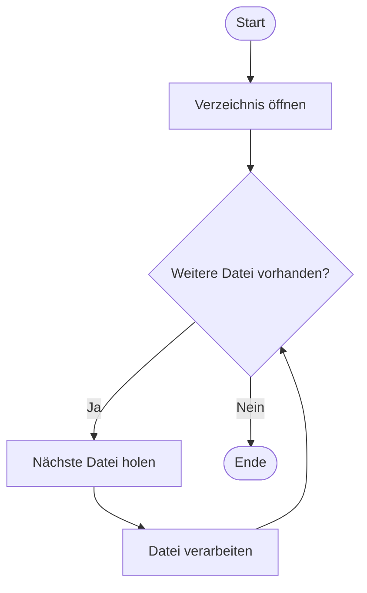

# Modul 122 – Einstiegsarbeit: Mermaid für PAP-Diagramme

**Name:** Erion Zejna
**Klasse:** ICT24A
**Datum:** 8.11.2026

---

## 1. Was ist Mermaid?

Mermaid ist ein JavaScript-basiertes Tool, das Diagramme aus einfachen Textbeschreibungen erstellt. Der Code wird direkt in Markdown-Dateien geschrieben und von GitHub, GitLab, VS Code usw. automatisch als Grafik dargestellt.

**Vorteile:**
- Versionierbar mit Git (es ist nur Text)
- Schnell änderbar, ohne Grafikprogramm
- Direkt in die Dokumentation (Readme.md) integrierbar

---

## 2. Verwendete PAP-Symbole

| PAP-Element | Mermaid-Syntax | Form |
|---|---|---|
| Start / Ende | `A([Start])` | abgerundet |
| Verarbeitung | `B[Datei lesen]` | Rechteck |
| Entscheidung | `C{Datei vorhanden?}` | Raute |
| Ein-/Ausgabe | `D[/Fehlermeldung/]` | Parallelogramm |
| Verbindung | `-->` | Pfeil |
| Beschriftete Verbindung | `-- Ja -->` | Pfeil mit Text |

---

## 3. Aufgaben

### Aufgabe 1: Einfacher linearer Ablauf

Die Schritte werden nacheinander ohne Verzweigung ausgeführt.

### Aufgabe 2: Ablauf mit Verzweigung

Es wird geprüft, ob eine Datei existiert. Je nach Ergebnis wird die Datei gelesen oder eine Fehlermeldung ausgegeben. Beide Wege führen zum selben Ende.

### Aufgabe 3: Ablauf mit Schleife

Alle Dateien im Verzeichnis werden nacheinander verarbeitet. Die Prüfung erfolgt vor der Verarbeitung (kopfgesteuerte Schleife), damit auch ein leeres Verzeichnis korrekt behandelt wird. Der Pfeil zurück zur Entscheidung erzeugt die Wiederholung.

---

## 4. Erkenntnisse

- Mit `graph TD` wird das Diagramm von oben nach unten aufgebaut.
- Jeder Knoten braucht eine eigene ID (A, B, C …).
- Entscheidungen (Rauten) haben immer zwei beschriftete Ausgänge (Ja / Nein).
- Eine Schleife entsteht, wenn ein Pfeil zu einem früheren Knoten zurückführt.

---

## 5. Ressourcen

| Quelle | Link / Hinweis |
|---|---|
| Mermaid-Editor | https://mermaid.live |
| Mermaid-Dokumentation | https://mermaid.js.org |
| VS Code Extension | "Markdown Preview Mermaid Support" |
| Modul-122-Bezug | HZ 1, Kompetenzband B1 |
